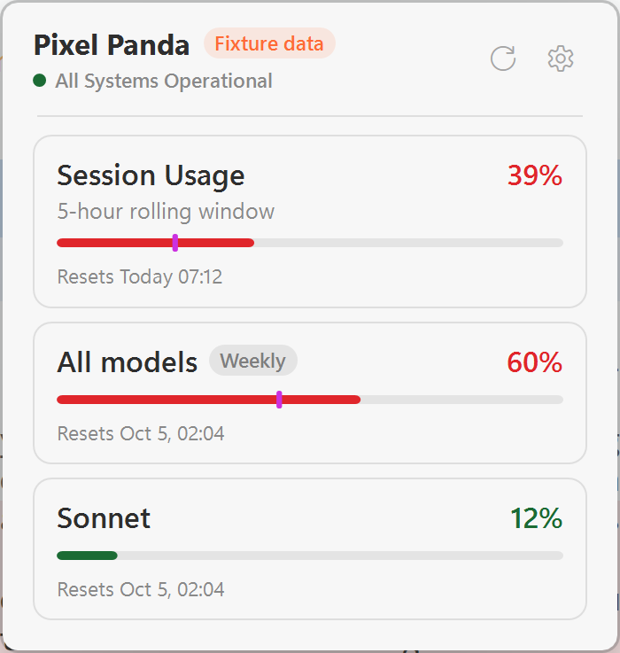
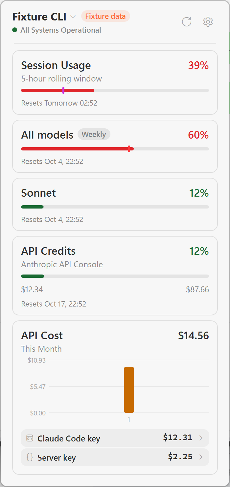
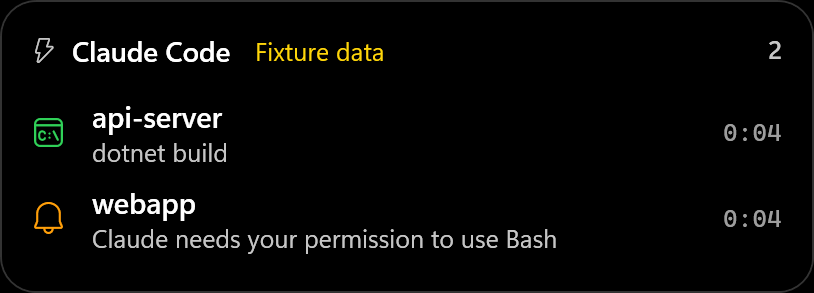

# Claude Usage Tracker for Windows

[](https://github.com/harningle/claude-usage-tracker/actions/workflows/ci.yml)
[](https://github.com/harningle/claude-usage-tracker/releases)
[](LICENSE)

A Windows port of [Claude Usage Tracker](https://github.com/hamed-elfayome/Claude-Usage-Tracker), hamed-elfayome's macOS menu bar app that shows how much of your Claude usage limits you have used. It lives in the Windows tray and keeps upstream's interface and behaviour wherever Windows allows, in C# with .NET 10 and WPF.

> **How this was made.** This is a port of the upstream app, not an original design, and it is entirely vibe coded: Claude Fable 5 and 5.1 and Claude Opus 5.5 wrote the plan, the code, the tests and the documentation, and GPT 6 Astra reviewed the code. The repository's owner set the scope, made the decisions recorded in [plan.md](plan.md) and ran the live checks on real accounts, and wrote none of the code by hand. Read [the parity matrix](docs/parity.md) for what is verified, how, and what is not, before you rely on it.

This port is not affiliated with, endorsed by or signed by Anthropic, OpenAI or the upstream author.

<p align="center">
  
  
</p>
<p align="center">
  
</p>
<p align="center"><sub>The screenshots come from fixture mode, on synthetic data, which is why they carry the "Fixture data" label. More are in <a href="docs/media">docs/media</a>.</sub></p>

## What it does

- **Tray icon and popover.** Session (5-hour), weekly and per-model usage with pace markers, the API Console credits and costs, Codex usage, the service status and a profile switcher. Five icon styles, monochrome and per-metric variants, and icons for several profiles at once.
- **Profiles.** Any number of Claude and Codex profiles, each with its own encrypted login and settings, and a setup wizard with four routes: Claude Code's login, claude.ai sign-in, the API Console, and the Codex CLI's login or pasted credentials.
- **Claude Code integration.** Read-only usage polling through Claude Code's own login; a status line with upstream's components and colour modes, rendered by a small native helper; a `claude-<profile>` launcher per profile with its own login folder; switching Claude Code's account to the picked profile, with backups; and a floating activity HUD fed by Claude Code's hooks.
- **Notifications and automation.** Threshold and reset notifications with Windows sounds, launch at login, global shortcuts, opt-in session auto-start (Claude and Codex) and profile auto-switch.
- **History.** Session, weekly and billing charts over 5 hours to 30 days, with JSON and CSV export.
- **Nothing phoned home.** No telemetry, no prompts, no cloud service, no automatic update. The Debug Tools page shows a request log without secrets.

Upstream features left out on purpose: the 13 other languages (the port is English only), the notch "Dynamic Island" (a floating window instead), Keychain storage (Windows DPAPI instead), automatic updates, the support, sponsor and mobile-app pages, and the star, feedback and heartbeat prompts. [docs/parity.md](docs/parity.md) lists every upstream feature, its status and each numbered difference.

## Requirements

- **Windows 11, x64**, with one person using the PC. The build targets Windows 10 version 2004 and later, but only Windows 11 has been tried; ARM64 and WSL are not supported.
- **Microsoft Edge WebView2 Runtime**, which Windows 11 includes, for claude.ai and API Console profiles.
- **Native Claude Code** (`claude.exe`) for Claude Code profiles, launchers and the status line, and the **Codex CLI** for Codex auto-start.

Nothing else: the app carries its own .NET 10 runtime and Windows App SDK.

## Install

Download from [Releases](https://github.com/harningle/claude-usage-tracker/releases):

- **`ClaudeUsageTracker-<version>-win-x64-setup.exe`** installs for the current user, without administrator rights, into `%LOCALAPPDATA%\Programs\ClaudeUsageTracker`, with a Start menu entry and an uninstaller under Settings → Apps. Run a newer installer to upgrade; quit the tracker first.
- **`ClaudeUsageTracker-<version>-win-x64.zip`** is the same build as a folder: unpack it somewhere permanent and run `ClaudeUsageTracker.App.exe`. [docs/personal-use.md](docs/personal-use.md) explains upgrading, moving and removing it.

The binaries are not code-signed, so SmartScreen shows "Windows protected your PC" the first time: choose More info, then Run anyway. `SHA256SUMS.txt` beside each release lets you check a download:

```powershell
Get-FileHash .\ClaudeUsageTracker-<version>-win-x64-setup.exe -Algorithm SHA256
```

On the first start the setup wizard links your first account. Windows puts the new tray icon in the overflow (^); drag it onto the taskbar to keep it in view.

Uninstalling removes the program files and asks whether to delete your settings, history and encrypted logins in `%LOCALAPPDATA%\ClaudeUsageTracker` as well; the default keeps them, and a silent uninstall keeps them unless it is run with `/DELETEDATA=1`. Launchers, the status line and launch at login stay until you switch them off in the app, so follow [Removing it](docs/personal-use.md#removing-it) first.

## What it touches on your PC

The tracker reads Claude Code's and Codex's own login files to poll usage. Read this before linking a real account; [docs/personal-use.md](docs/personal-use.md#where-things-are) has every path.

- Its settings, history and logins live under `%LOCALAPPDATA%\ClaudeUsageTracker`. Logins are encrypted with Windows DPAPI for your user on this PC, so a copy is no use elsewhere.
- Polling never writes Claude Code's login. The tracker writes it in two cases only: to hand back a login it renewed because Claude Code's had expired while no Claude Code was running, and to switch Claude Code's account when you ask, by picking a profile, choosing Use in Claude Code or switching on auto-switch. Every other field is preserved and encrypted backups are kept. It never writes Codex's login file.
- The status line and the activity hooks are entries in Claude Code's `settings.json`. The hooks only observe: they never approve prompts, inject context or send input, and a clean quit removes them.
- Polling never sends model requests. Session auto-start, which does, is off until you switch it on.
- Network requests go only to the Anthropic and OpenAI services the features need (claude.ai, platform.claude.com, console.anthropic.com, api.anthropic.com, status.claude.com, chatgpt.com, auth.openai.com, api.openai.com and status.openai.com) and to Claude Code's hooks on 127.0.0.1.

## Building from source

You need the .NET SDK 10.0.403 or a later patch ([global.json](global.json)) and, for the NativeAOT helper, Visual Studio 2022 or its Build Tools with the C++ desktop workload. From the repository root:

```powershell
dotnet publish src/ClaudeUsageTracker.Helper/ClaudeUsageTracker.Helper.csproj -c Release -r win-x64
dotnet build ClaudeUsageTracker.slnx
dotnet test --solution ClaudeUsageTracker.slnx
dotnet publish src/ClaudeUsageTracker.App/ClaudeUsageTracker.App.csproj
```

Publish the helper first: the app's build copies it to `helper\` beside the app. Build output goes to `%LOCALAPPDATA%\ClaudeUsageTracker.Build\<checkout-id>` rather than into the checkout ([Directory.Build.props](Directory.Build.props)); the published app is under `publish\ClaudeUsageTracker.App\release_win-x64` there.

To see the app without touching a real account, run it in fixture mode on synthetic files and canned responses, as described in [docs/milestone-2.md](docs/milestone-2.md):

```powershell
dotnet run --project src/ClaudeUsageTracker.App -- --fixture <folder>
```

Started normally, the app reads your real Claude Code login and polls with it.

## Status and documentation

Milestones 0 to 6 of [plan.md](plan.md) are done: the port has been in daily personal use since early October 2026, with about 1,400 automated tests, including ones that run the real helper and launcher processes under PowerShell, Command Prompt and Git Bash. Milestone 7, public distribution, is under way: CI, the release workflow and the installer exist, and the first releases are betas. The binaries stay unsigned by decision, an update check is planned for a later version, and installs on other PCs await the first testers.

- [plan.md](plan.md): the design, the Windows adaptations and their reasons, the milestones and the verification rules.
- [docs/parity.md](docs/parity.md): every upstream feature's status, the numbered differences, and the verification limits, among them that Max and Enterprise accounts, the Console live, remote desktop, screen readers and a clean PC are unverified.
- [docs/milestone-1.md](docs/milestone-1.md) to [docs/milestone-6.md](docs/milestone-6.md): what each milestone did, found and fixed.
- [docs/personal-use.md](docs/personal-use.md): the folder build, data locations, upgrades and removal.
- [CHANGELOG.md](CHANGELOG.md): changes by version.

Bug reports and questions go to [Issues](https://github.com/harningle/claude-usage-tracker/issues). Please do not post login files, session keys or the data folder; the request log in Debug Tools is safe to share.

## Releasing

1. Turn the `Unreleased` section of [CHANGELOG.md](CHANGELOG.md) into `## [X.Y.Z] - YYYY-MM-DD`, start a new empty `Unreleased` above it, and commit.
2. Tag and push: `git tag vX.Y.Z`, then `git push origin main vX.Y.Z`. A suffix such as `v1.1.0-beta.1` makes a pre-release.
3. The [release workflow](.github/workflows/release.yml) builds and tests, publishes the app with that version, compiles the installer with Inno Setup, zips the portable folder, and creates the GitHub release with the changelog section as its notes.

## Licence and attribution

MIT, as upstream: see [LICENSE](LICENSE), which keeps upstream's copyright line beside the port's. The port embeds upstream's English `Localizable.strings` unchanged and ports its logic and interface; upstream's artwork, fonts, symbols and sounds are not redistributed. Claude and Claude Code are Anthropic's products and Codex is OpenAI's; this project is affiliated with neither.
